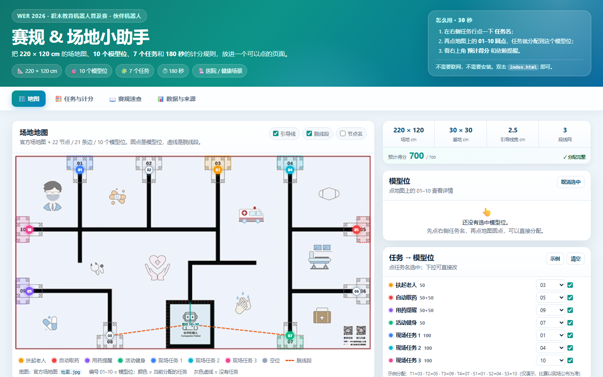
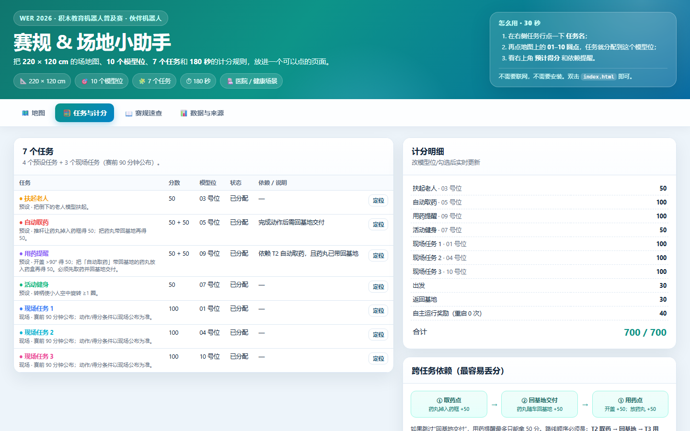
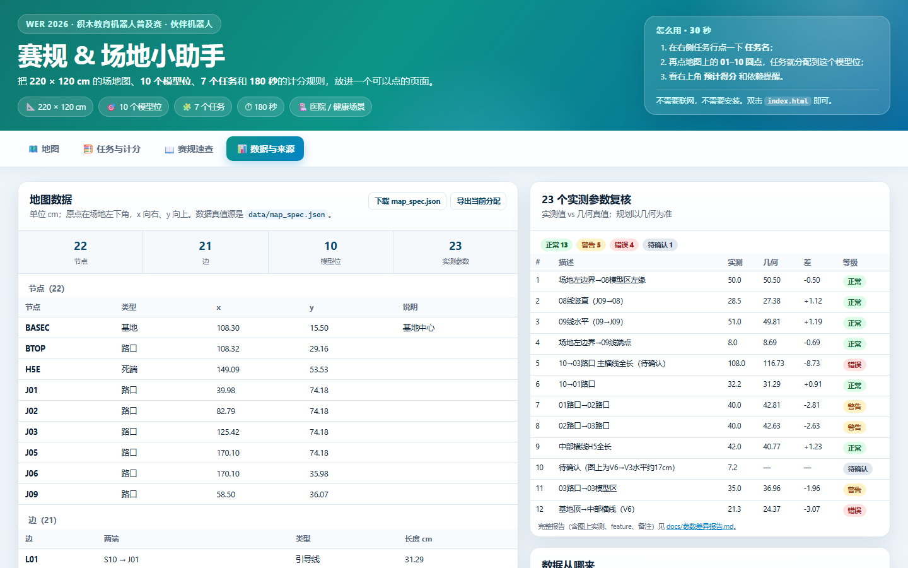

<div align="center">

# 🗺️ WER 2026 · 赛规 & 场地小助手

### 点任务 → 点模型位 → 看分数和依赖

<p>
  
  
  
  
  
</p>

**一个双击就能用的比赛现场小工具：**
把 220×120 cm 的场地图、10 个模型位、7 个任务和 180 秒的计分规则，放进一个可以点的页面。

<p>
  
</p>

</div>

---

## 🚀 3 秒上手

**双击 `index.html`**（或 `打开小助手.cmd`）即可。

- 不需要联网
- 不需要安装 Python / Node
- 不需要本地服务器
- 手机/平板/电脑浏览器都能打开（双击文件即可）

> 推荐用 Chrome / Edge。页面只读取同目录下的图片和 JS 数据，`file://` 就能工作。

### 怎么用

1. 在右侧任务行点一下 **任务名**（例如“扶起老人”）；
2. 再点地图上的 **01–10 圆点**，任务就分配到这个模型位；
3. 看右上角 **预计得分**，以及任务行里的 `!` 依赖提醒；
4. 想改分配：直接用任务行的下拉框，或再点一次任务名重新选位。

<p align="center">
  
  
</p>
<p align="center"><sub>左：任务与计分明细 · 右：22 节点 / 21 边 / 23 个实测参数复核</sub></p>

---

## ✨ 这个助手解决什么问题

比赛现场最容易出错的不是“不会写程序”，而是：

- 任务模型位随机公布，**7 个任务到底放哪**？
- 哪些任务有**前置依赖**，先做哪个？
- 180 秒内做哪些、跳过哪些，**大概能拿多少分**？
- 场地上哪些位置在**左边线网 / 右边线网 / 08-09 支线**，要不要回基地？
- 官方地图上的尺寸/编号，和现场实物对不上时看哪个？

这个小助手把这些问题收进一个页面：

| 功能 | 说明 |
|---|---|
| 🗺️ **可点的场地地图** | 官方场地图做底图；01–10 圆点 = 模型位；颜色 = 分配的任务 |
| 🧩 **任务 → 模型位** | 点任务名再点地图圆点；下拉框直接改；重复模型位自动交换 |
| 🎯 **计分器** | 任务分 + 出发 30 + 返回 30 + 自主 40−10×重启；实时显示 /700 |
| ⚠️ **依赖提醒** | 用药提醒需要先取药并带回基地；不满足时明确提示“最多 50 分” |
| 📖 **赛规速查** | 场地、时间、机器人限制、7 个任务分值、跨任务依赖 |
| 📊 **数据与来源** | 22 节点 / 21 边 / 23 个实测参数；几何差 ≤ 0.2 cm 的复核结论 |
| 💾 **本地保存 / 导出** | 分配结果存 localStorage；可导出 `任务分配_本助手.json` |

---

## 🗺️ 地图：3 段线网，不是“两个网”

很多资料会简单说“左右两个网”。实际把黑线抽象成图后是：

| 线网 | 内容 | 怎么进 |
|---|---|---|
| **左网** | 10 → 01/02/03 主横线 → 03 竖线 → 中部横线 → V6 → 基地；01/02 从 J01/J02 上去 | 基地沿 V6 向上，**有黑线** |
| **右网** | 04 → V4 竖线 → 05 / 06 两个路口 → 07 | 基地→07 **脱线 62.0 cm** |
| **08-09 支线** | 09 → J09 → 08 | 基地→08 **脱线 50.3 cm** |

再加上 **1 条基地段**，一共：

- **22 个节点**
- **21 条边**：19 条引导线 + 1 条基地段 + 2 条脱线段
- **3 段互不连通的引导线**（不是 2 段）

> 这条修正很重要：如果以为“只有左右两个网”，会把 08-09 支线误当成左网的一部分，路线/程序就会走错。

### 基地与模型位

| 项 | 值 |
|---|---|
| 场地 | 220 × 120 cm |
| 基地 | 30 × 30 cm，底部中央，中心 (108.30, 15.50) |
| 模型位 | 01–10；模型区 16×8 / 8×16 cm |
| 引导线 | 2–3 cm（图上按 2.5 cm 建模） |
| 图片标定 | 5.641 px/cm；边界 x=11..1252、y=8..685 |

模型朝向：

| 位置 | 朝向 |
|---|---|
| 01–04（上边） | 270°（朝场内/向下）**推断，现场确认** |
| 05 / 06（右边） | 180°（朝场内/向左） |
| 07 / 08（下边） | 90°（朝场内/向上） |
| 09 / 10（左边） | 0°（朝场内/向右） |

> 01–04 的红色箭头只有约 1.5 cm，图上无法判读箭头尖方向；270° 是按“红标记在模型区靠场内一侧”推断的。**比赛现场以实物为准。**

---

## 🧮 计分规则（页面里的算式）

| 项 | 分数 |
|---|---|
| 出发 | 30 |
| 返回基地 | 30 |
| 扶起老人 | 50 |
| 自动取药 | 50（落药）+ 50（带回基地） |
| 用药提醒 | 50（开盖 >90°）+ 50（放入药丸） |
| 活动健身 | 50 |
| 现场任务 ×3 | 各 100 |
| 自主运行奖励 | 40 − 10 × 重启次数（≥0） |

**满分示例**：600（任务）+ 30 + 30 + 40 = **700 分**。

### 跨任务依赖

```
自动取药（+50 落药）
      ↓ 把药丸带回基地（+50）
用药提醒（+50 开盖）
      ↓ 把带回的药丸放入药盒（+50）
```

合法顺序：**取药点 → 回基地交付 → 用药点**。
如果跳过“回基地交付”，用药提醒最多 50 分。

> [!IMPORTANT]
> 页面里的计分是**我们自己按公开资料整理的算式**，用于赛前快速估算：
> - 出发/返回按“第一次离场/最后一次回基地”计一次（我们的理解）；
> - 不含超时、犯规、重试失败、机构未完成等判罚；
> - 最终以裁判现场解释为准。

---

## 📊 数据从哪来

| 数据 | 来源 |
|---|---|
| 场地尺寸/线宽/基地 | 2026 年赛规 + 官方场地图 |
| 22 节点 / 21 边 | 官方场地图像素骨架上人工抽象 |
| 模型区/朝向 | 图上细线矩形 + 红色箭头标记（01–04 为推断） |
| 23 个实测参数 | 用户尺量值，逐条与几何比对 |
| 计分 | 赛规计分表 + 公开资料 |

**复核结论**：

- 像素标定 5.641 px/cm；11 条粗线中心、13 个节点、基地外沿、10 个模型区与图差 **≤ 0.2 cm**。
- 23 个尺量参数：**13 正常 / 5 警告 / 4 错误 / 1 待确认**。
- 规划/页面一律用几何值；尺量值只用来核对，不用来反推几何。

详见 [`docs/场地几何.md`](docs/场地几何.md)、[`docs/参数差异报告.md`](docs/参数差异报告.md)、[`docs/数据来源.md`](docs/数据来源.md)。

---

## 📁 项目结构

```text
WER-2026-Map-Assistant/
├─ index.html                 主页面（4 个页签）
├─ style.css                  样式
├─ app.js                     地图渲染/任务分配/计分
├─ 打开小助手.cmd             双击打开 index.html
├─ data/
│  ├─ map_spec.json           地图真值源（220×120 几何）
│  ├─ map-data.js             自动生成：window.WER_MAP
│  ├─ params.js               自动生成：23 个参数复核
│  └─ tasks.js                7 个任务/分值/颜色/依赖
├─ assets/
│  ├─ 地图.jpg                官方场地图
│  ├─ 地图标注结果.jpg         23 个尺量参数原图
│  └─ 2026年赛规.pdf          官方赛规
├─ docs/
│  ├─ 场地几何.md
│  ├─ 赛规速查.md
│  ├─ 数据来源.md
│  ├─ 参数差异报告.md
│  └─ screenshots/            主界面/任务页/数据页截图
├─ tools/
│  ├─ build_data.py           从 map_spec + 参数报告生成 JS 数据
│  └─ validate_data.py        校验 22/21/10/3 段线网/23 参数
└─ tests/
   └─ test_ui.py              Playwright 无服务器 UI 测试
```

---

## 🛠️ 开发 / 自测

```bash
# 重新生成 data/map-data.js + data/params.js
python tools/build_data.py

# 校验数据：22 节点 / 21 边 / 10 模型位 / 3 段线网 / 23 参数
python tools/validate_data.py

# UI 测试：file:// 打开，验证 10 个模型位、700 分、分配、依赖、7 任务、22 节点、21 边、23 参数
python tests/test_ui.py
```

UI 测试需要 Playwright（本机已装）：

```bash
python -m pip install playwright
python -m playwright install chromium
```

测试会生成/更新 `docs/screenshots/` 下的三张截图。

---

## ⚠️ 已知边界

- 这是**赛规/地图小助手**，不是路线规划器，也不生成车上程序；配套的路线工具是另一个更大的项目。
- 页面不做真实倒计时；180 秒只是计分/预算提示。
- 01–04 的模型朝向是推断，现场必须确认。
- 计分是估算，出发/返回/自主奖励的判定细节以裁判为准。
- 空模型位在比赛中可能存在；空位不要当成任务。
- 如果你在别的电脑上打开，`file://` 的 localStorage 可能按浏览器策略不同；导出 JSON 可以跨电脑带走分配。

---

## 📜 版权与致谢

- 官方场地图、赛规 PDF：版权归赛事主办方 / 能力风暴所有；本仓库仅用于本队学习与比赛准备。
- 本页面代码与整理文档：可自由用于学习、教学和比赛准备；转载请注明出处。
- 不要把从官方软件安装包里提取的资源再分发。
- 感谢提供 23 个实测参数、场地图和现场反馈的队友/家长。

---

<div align="center">

**先把“做哪个任务、放哪个位、大概多少分”想清楚，再谈路线和程序。**

<sub>WER 2026 · 伙伴机器人 · 赛规 & 场地小助手</sub>

</div>
